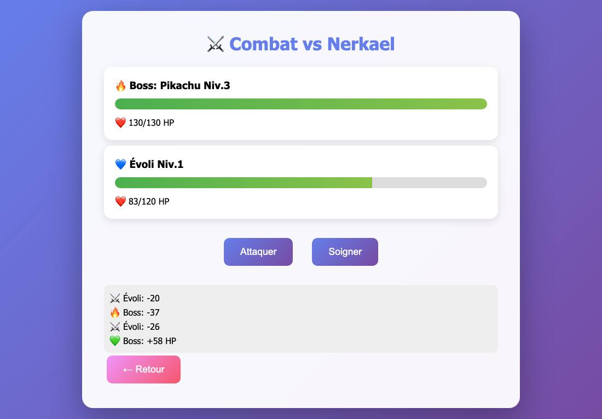

# Pokémon Game

> **C'est l'un de mes tout premiers jeux !** La suite est dans [Pokemon-Game-2.0](https://github.com/Alex12062012/Pokemon-Game-2.0).

Un jeu web inspiré de Pokémon : on ouvre des boosters pour former une équipe, puis on affronte 5 boss de plus en plus forts.

| Menu | Booster | Combat |
|---|---|---|
|  |  |  |

## Le jeu

- **Boosters (50 €)** : un Pokémon au hasard, du Pikachu commun au Mew mythique (2 % de chances).
- **Combats au tour par tour** : *Attaquer* (15 % de coups critiques) ou *Soigner*. Le boss peut aussi se soigner.
- **Progression** : XP et niveaux pour les Pokémon. Une victoire rapporte de l'argent, une défaite +25 €.
- **Reste du jeu** : on peut revendre des Pokémon et soigner l'équipe. Il y a des comptes joueurs, des sauvegardes, et trois langues (FR / EN / RU).

## Les fichiers

| Fichier | Contenu |
|---|---|
| `Qwen_python_20260113_llvcbh3vy.py` | la toute première version |
| `Qwen_python_20260113_8ii4z3f7i.py` | la version corrigée, la même que dans Pokemon-Game-2.0 |
| `Qwen_bash_20260113_izgn8iitv.sh` | les commandes d'installation et de lancement |

Le code a été écrit avec l'aide de l'assistant IA Qwen, d'où les noms des fichiers.

## Lancer le jeu

```bash
pip install flask
python Qwen_python_20260113_8ii4z3f7i.py
```

Ouvre ensuite http://localhost:5000.

**Bugs connus de la première version, corrigés dans l'autre fichier :**
- l'écran de victoire plante (`'len' is undefined`) ;
- le combat se trompe de Pokémon dès qu'un membre de l'équipe est K.O.

---
*Projet de fan, non officiel. Pokémon est une marque de Nintendo / Creatures / Game Freak.*
